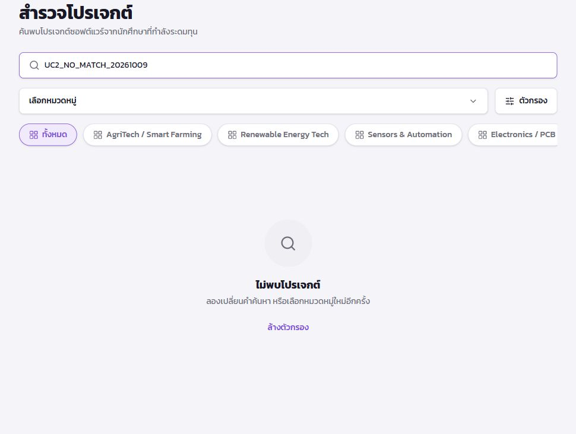
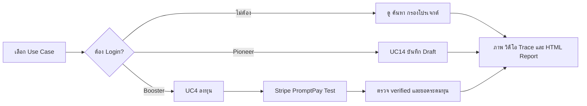

# FlyUp Playwright Tests


[](https://github.com/apisara05/playwright-Flyup/actions/workflows/source-checks.yml)

**6 Use Case · 13 เคสหลัก · 2 Login setup · ภาพ วิดีโอ และ Trace**

[เริ่มใช้งาน](#ติดตั้ง) · [คำสั่งรัน](#รันทดสอบ) · [สถานะล่าสุด](#สถานะราย-use-case) · [Roadmap](#แผนพัฒนาต่อ) · [Release](https://github.com/apisara05/playwright-Flyup/releases)

ชุดทดสอบ End-to-End ด้วย **JavaScript และ Playwright** สำหรับเว็บไซต์ https://www.fly-up.app/ ครอบคลุมฟังก์ชันหลัก UC1, UC2, UC3, UC4, UC10 และ UC14

## ตัวอย่างจากเว็บไซต์จริง



ตัวอย่าง UC2 การค้นหาคำที่ไม่มีโปรเจกต์และการแสดงข้อความ “ไม่พบโปรเจกต์” ภาพเก็บวันที่ 9 ตุลาคม 2569 และตัดส่วนเมนูบัญชีออก ภาพนี้เป็นหลักฐานการตรวจหน้าจอ ไม่ใช่หลักฐานว่าชุดเทสทั้งหมดผ่าน

## เส้นทางการทดสอบ



## สิ่งที่ทดสอบ

| Use Case | ฟังก์ชัน | ขอบเขต |
|---|---|---|
| UC1 | ดูโปรเจกต์ | เปิดรายการและรายละเอียด |
| UC2 | ค้นหาโปรเจกต์ | ค้นหาชื่อ ไม่พบผล และล้างตัวกรอง |
| UC3 | เลือกหมวดหมู่ | กรองหมวดหมู่และกลับไปทั้งหมด |
| UC4 | ลงทุนโปรเจกต์ | 7 เคส รวม validation, ย้อนกลับ และ Stripe PromptPay Test |
| UC10 | เข้าสู่ระบบ | หน้า Google Login และ auth setup |
| UC14 | สร้างโปรเจกต์ | เคสหลักกรอกข้อมูลพื้นฐาน Story และ 4 Milestone บันทึก Draft |

ชุดนี้เป็นเคสหลัก ไม่ใช่ชุดครบ 212 Test Case

## ติดตั้ง

ใช้ Node.js 22 หรือใหม่กว่า เปิด Terminal ในโฟลเดอร์ที่มี package.json

```powershell
npm install
npx playwright install chromium
Copy-Item .env.example .env
```

ใส่ข้อมูลบัญชีทดสอบใน `.env` ของเครื่องตนเอง ห้าม commit `.env` หรือ session ใน `playwright/.auth/`

## ตั้งค่าบัญชีและข้อมูล

| ตัวแปร | ใช้สำหรับ |
|---|---|
| UC4_LOGIN_MODE | password หรือ google |
| UC4_EMAIL / UC4_PASSWORD | บัญชี Booster ของผู้รัน |
| UC4_PROJECT_ID | ID โปรเจกต์ที่กำลังระดมทุน |
| UC4_ACCEPT_TERMS | true ให้เทสติ๊กและกดยอมรับสัญญา; false ให้ทำเอง |
| UC4_PAYMENT_MODE | stripe-test สำหรับชำระจำลองผ่าน Stripe Test Page |
| UC4_RUN_PAYMENT | false โดยปกติ; true เปิดขั้นตอนชำระด้วยตนเอง |
| UC14_PROJECT_ID | ID Draft ทดสอบของ Pioneer; เว้นว่างเพื่อสร้างใหม่ |
| UC14_API_ORIGIN | API origin ของ FlyUp |

UC4 ต้องใช้ Booster ที่ผ่าน KYC มีเบอร์โทรและผูกธนาคาร UC14 ต้องใช้ Pioneer Google Login ต้องทำในเบราว์เซอร์ที่เทสเปิดให้ รวมถึง OTP/MFA; session ในเบราว์เซอร์ Codex ไม่ได้โอนเข้า Playwright อัตโนมัติ

UC14 เขียนข้อมูลลง Draft จริง ให้เลือก Draft ทดสอบที่อนุญาตให้แก้ไขได้ เว็บไซต์จำกัด Draft 5 รายการ Mockup อยู่ใน `fixtures/project-data.json` และไฟล์ภาพ เป้าหมาย 100000 บาท Milestone 15/20/30/35% ชุดเคสหลักนี้ไม่ส่งคำขอให้ Admin

## รันทดสอบ

```powershell
# ฟังก์ชัน public เท่านั้น
npm test
npm run ui

# UC4
npm run uc4
npm run uc4:ui
npm run uc4:list

# เฉพาะชำระจำลอง Stripe
npm run uc4 -- --grep TC4_001

# เฉพาะกลับก่อนชำระ
npm run uc4 -- --grep TC4_007

# UC14 พร้อม Pioneer Login
npm run uc14
npm run uc14:ui

# ทั้งชุด (อาจต้อง Login ทั้งสองบทบาท)
npx playwright test --headed

# แสดงรายงาน
npm run report
```

Playwright UI Mode อาจต้องรัน auth project ก่อนหากยังไม่มี session: `npm run auth` สำหรับ Pioneer และ `npm run auth:uc4` สำหรับ Booster

## Stripe PromptPay Test

ตั้ง `UC4_PAYMENT_MODE=stripe-test` เทสจะยืนยันรายการ อ่าน URL จาก QR ด้วย pngjs/jsqr และเปิดในแท็บใหม่ ตรวจ HTTPS host `payments.stripe.com`, หัวข้อ `PromptPay test payment page` และยอดเงินก่อนกด `#authorize-payment-btn` ซึ่งเป็นปุ่ม Authorize Test Payment

หลังจากนั้นรอระบบ FlyUp คืนสถานะ `verified` และแสดงหน้าสำเร็จ จากนั้นอ่านยอดระดมทุนซ้ำสูงสุด 60 วินาที ไม่ปลอม webhook หรือแก้ยอดเพื่อให้เทสผ่าน หาก QR ไม่ใช่ Stripe Test Page เทสจะหยุดการ authorize

โหมด Stripe Test ไม่ต้องใช้ Stripe secret key ใน repository นี้

## เคสที่อาจถูกข้าม

- TC4_005 ข้ามตามโค้ดเดิม เพราะตอนตรวจเว็บไซต์ยังไม่พบเงื่อนไขยอดค้างต่ำกว่า 500 บาท/ปุ่มปิดยอดตามข้อกำหนด ต้องตรวจเว็บใหม่ก่อนปรับเคส
- TC4_001 ข้ามเมื่อไม่ได้เปิด stripe-test หรือโหมดชำระ และเมื่อโปรเจกต์รับยอด 1000 บาทไม่ได้
- TC4_006 ต้องเปิดโหมดชำระ และโปรเจกต์เหลือยอด 3500 บาทพอดี

Skipped ไม่ใช่ Pass

## ภาพ วิดีโอ และ Trace

การทดสอบเปิด `video: on`, `screenshot: on`, `trace: on` ผลอยู่ใน `test-results/<เคส>/` วิดีโอชื่อ `video*.webm` จะเสร็จเมื่อปิด browser context เปิด `npm run report` เพื่อดู attachments ส่วน auth setup ปิดการบันทึกสื่อเพื่อไม่บันทึกข้อมูลเข้าสู่ระบบ

## โครงสร้าง

```text
tests/
  uc1.spec.js
  uc2.spec.js
  uc3.spec.js
  uc4.spec.js
  uc10.spec.js
  uc14.spec.js
  auth.setup.js
  helpers/
    public.js
    project.js
  uc4/
    auth.setup.js
    helpers/
      investment.js
      stripe-test.js
fixtures/
.env.example
playwright.config.js
package.json
```

## ปัญหาที่พบบ่อย

- Missing script uc4: ตรวจว่าเปิด Terminal ในโฟลเดอร์ package.json ของชุดนี้
- Cannot find package pngjs: รัน npm install
- พอร์ต report ถูกใช้: npm run report ใช้ port 0 ให้ระบบเลือกพอร์ตว่าง
- spawn EPERM: ระบบที่ใช้รันไม่อนุญาตเปิด Chromium ให้รันจาก Terminal เครื่องที่อนุญาต
- verified แต่ยอดระดมทุนไม่เพิ่ม: เทสรอยอด 60 วินาทีแล้ว Fail หากยังไม่เพิ่ม ต้องตรวจ webhook/การอัปเดตข้อมูลฝั่ง FlyUp

## สถานะการตรวจสอบ

มีการตรวจ syntax และค้นพบเคสผ่าน Playwright ข้อมูล Trace ของผู้รันยืนยันว่าชำระ Stripe Test ได้สถานะ verified แต่ยอดระดมทุนยังไม่เพิ่มในรอบนั้น จึงเพิ่ม polling โดยคง assertion เดิมไว้ ยังไม่ยืนยันว่าทุกเคสผ่านหลังแก้ล่าสุด

## สถานะราย Use Case

อัปเดต 9 ตุลาคม 2569 ตารางนี้อ้างอิงโค้ดและหลักฐานในงานนี้ ไม่ใช่ผลรันใหม่ทั้งชุด

| Use Case | จำนวนเคสหลัก | สถานะที่ยืนยันได้ | สิ่งที่ต้องตรวจต่อ |
|---|---:|---|---|
| UC1 | 1 | โหลดรายชื่อเทสได้; ตรวจหน้ารายละเอียดจากเว็บ | รันชุดล่าสุด |
| UC2 | 2 | โหลดรายชื่อเทสได้; มีภาพไม่พบผลค้นหา | รันชุดล่าสุด |
| UC3 | 1 | โหลดรายชื่อเทสได้; ตรวจปุ่มหมวดหมู่จากเว็บ | รันชุดล่าสุด |
| UC4 | 7 | Trace ของ TC4_001 ระบุ verified แต่ Fail ที่ยอดระดมทุน | ยืนยัน polling และยอดฝั่งระบบ; 005/006 มีเงื่อนไข Skip |
| UC10 | 1 | เข้าสู่ระบบ Pioneer ผ่าน Google ในเบราว์เซอร์แอปได้ | ยืนยัน auth ผ่าน Playwright ของผู้รัน |
| UC14 | 1 | โหลดรายชื่อเทสได้; มี mockup และ helper | รันกับ Draft ทดสอบและบัญชี Pioneer |

รวม 13 เคสหลัก + 2 auth setup = 15 รายการจาก `playwright test --list` ไม่รวมชุด UC14 เต็ม 14 เคสซึ่งอยู่นอก repository ชุดนี้

## แผนพัฒนาต่อ

- [x] แยกไฟล์ตาม Use Case พร้อม mockup
- [x] บันทึกภาพ วิดีโอ และ Trace
- [x] อ่าน QR และ authorize Stripe Test Page
- [x] เพิ่มรออ่านยอดหลังชำระ 60 วินาที
- [ ] ตรวจและแก้ปัญหา verified แต่ยอดระดมทุนไม่เพิ่ม
- [ ] ปรับ TC4_005 ให้ตรง requirement และเว็บไซต์ล่าสุด
- [ ] จัดโปรเจกต์ทดสอบที่มียอดคงเหลือสำหรับ TC4_006
- [ ] เพิ่ม UC14 จากเคสหลักเป็นครบ 14 เคส
- [ ] เพิ่มหลักฐานวิดีโอที่ตัดข้อมูลบัญชีแล้ว

## CI และการมีส่วนร่วม

GitHub Actions ตรวจ JavaScript syntax และค้นพบเทสโดยไม่รัน flow ของเว็บ ชื่อ badge คือ Source checks จึงไม่หมายถึง E2E ทุกเคสผ่าน สามารถรายงานปัญหาพร้อม Case ID, expected/actual และภาพที่ตัดข้อมูลบัญชีออกใน [Issues](https://github.com/apisara05/playwright-Flyup/issues)

ดู [CHANGELOG](CHANGELOG.md) และ [Release notes v1.0.0](docs/RELEASE-v1.0.0.md) สำหรับขอบเขตของรุ่น
